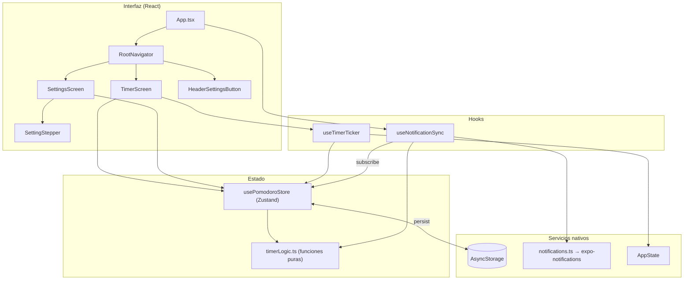
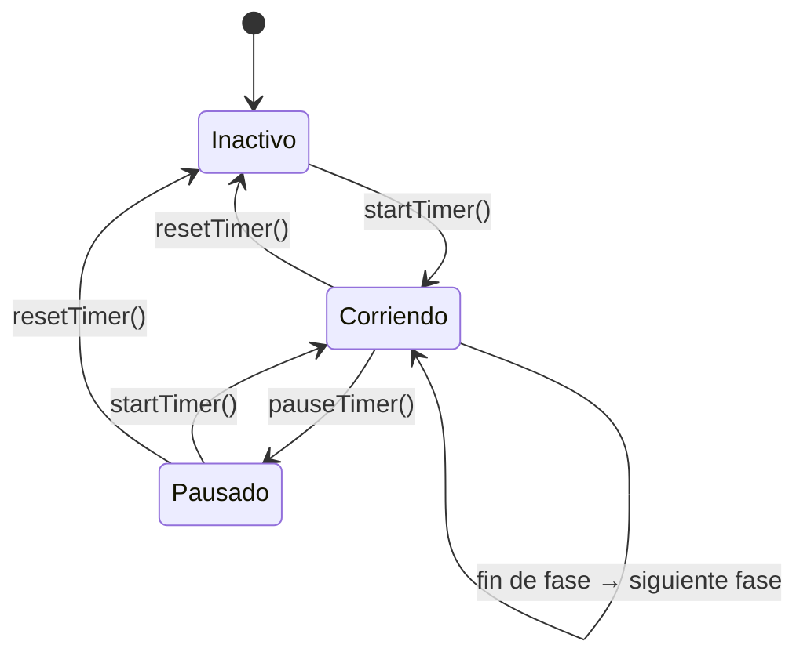
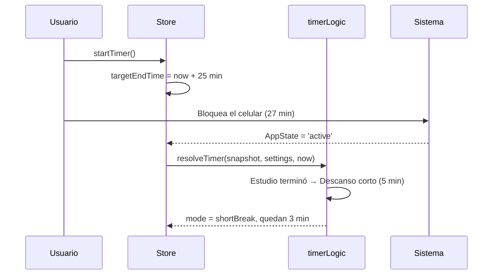
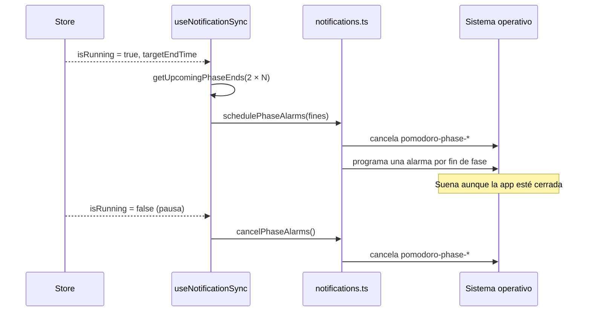

# Arquitectura - Pomodoro Cotopaxi

Este documento explica cómo está organizada la app por dentro y por qué se tomaron las decisiones principales.

---

## 1. Vista general

La app tiene tres capas. Las pantallas solo leen el estado y llaman acciones; toda la lógica del temporizador vive en funciones puras que no dependen de React, lo que permite probarla con tiempos simulados.



| Capa | Archivos | Responsabilidad |
| :--- | :--- | :--- |
| Interfaz | `screens/`, `components/`, `navigation/` | Mostrar el estado y disparar acciones. Sin lógica de tiempos. |
| Hooks | `hooks/` | Conectar el store con eventos del sistema (intervalos, `AppState`, notificaciones). |
| Estado | `store/` | Estado global, acciones y persistencia. |
| Lógica pura | `store/timerLogic.ts` | Cálculo de fases, tiempos y validación. Recibe `now` como parámetro. |
| Servicios | `services/notifications.ts` | Única puerta de entrada a `expo-notifications`. |

---

## 2. Estado global

El store (`src/store/usePomodoroStore.ts`) sigue el contrato de `state-skill.md`:

| Campo | Tipo | Significado |
| :--- | :--- | :--- |
| `settings` | `PomodoroSettings` | Duraciones (min) y pomodoros por ciclo |
| `mode` | `'work' \| 'shortBreak' \| 'longBreak'` | Fase actual |
| `isRunning` | `boolean` | El temporizador está corriendo |
| `isPaused` | `boolean` | Se pausó a mitad de una fase |
| `timeRemaining` | `number` | Segundos restantes que se muestran en pantalla |
| `completedPomodoros` | `number` | Pomodoros completados en el ciclo actual |
| `targetEndTime` | `number \| null` | Timestamp (ms) en que termina la fase en curso |

Estados posibles del temporizador:



**Persistencia.** El middleware `persist` guarda en AsyncStorage tanto `settings` como el estado del temporizador (`partialize`). Al reabrir la app, `merge` valida los ajustes guardados con `sanitizeSettings` y `onRehydrateStorage` llama a `syncBackgroundTime()` para recuperar el tiempo transcurrido.

**Ajustes durante una sesión.** Si el temporizador está inactivo, `updateSettings` actualiza el tiempo mostrado de inmediato. Si hay una sesión en curso o en pausa, la fase actual no se recorta: el cambio se aplica desde la siguiente fase o al reiniciar.

---

## 3. Tiempo en segundo plano (HU-003)

El temporizador no cuenta segundos con `setInterval`. Al iniciar guarda el instante de fin:

```text
targetEndTime = Date.now() + timeRemaining × 1000
```

El intervalo de `useTimerTicker` (cada 500 ms) solo **recalcula** el tiempo restante a partir de ese timestamp, así que un intervalo atrasado o detenido no altera la cuenta:

```text
timeRemaining = ⌈(targetEndTime − Date.now()) / 1000⌉
```

> Se usa `Math.ceil` en lugar del `Math.floor` de `state-skill.md` para que el contador muestre 25:00 al pulsar Iniciar en vez de saltar a 24:59.

Cuando la app vuelve a primer plano (`AppState === 'active'`) o se reabre, `resolveTimer` avanza por todas las fases que terminaron mientras tanto, encadenando sus tiempos de fin:



**Pausa.** `pauseTimer` guarda los segundos restantes y borra `targetEndTime`, así el tiempo en pausa no cuenta.

---

## 4. Ciclos Pomodoro (HU-002)

`getNextPhase` decide la siguiente fase:

| Fase que termina | Siguiente fase | Contador |
| :--- | :--- | :--- |
| Estudio (contador + 1 < N) | Descanso corto | +1 |
| Estudio (contador + 1 ≥ N) | Descanso largo | +1 |
| Descanso corto | Estudio | se mantiene |
| Descanso largo | Estudio | vuelve a 0 |

Con los valores por defecto (N = 4) un ciclo completo dura 4 × 25 + 3 × 5 + 15 = **130 minutos**. Al terminar una fase la siguiente empieza sola.

---

## 5. Notificaciones y alarma (HU-004)

Como la app puede estar cerrada cuando termina una fase, las alarmas se programan **por adelantado** en el sistema operativo:

1. Al iniciar la app, `useNotificationSync` llama a `initializeNotifications()`: pide el permiso de notificaciones y crea el canal `pomodoro-alarm`.
2. Si falta un permiso, muestra un aviso. En Android ofrece abrir el ajuste de "Alarmas y recordatorios".
3. El hook se suscribe al store. Cada vez que cambian `isRunning`, `targetEndTime` o `settings`:
   - si el temporizador corre, `getUpcomingPhaseEnds` calcula los fines de las próximas `2 × N` fases (un ciclo completo) y `schedulePhaseAlarms` reemplaza las alarmas programadas;
   - si se pausó o reinició, `cancelPhaseAlarms` las cancela.
4. Las sincronizaciones se ejecutan **en serie** y cada una lee el estado más reciente, para que pulsar Iniciar y Pausar muy rápido no deje alarmas viejas.



**Configuración del canal y la notificación**

| Opción | Valor | Para qué |
| :--- | :--- | :--- |
| `importance` | `MAX` | Notificación emergente con sonido |
| `sound` | `default` | Sonido del sistema |
| `vibrationPattern` | 400/600 ms × 3 | Vibración marcada |
| `audioAttributes.usage` | `ALARM` (+ `enforceAudibility`) | Suena por el volumen de alarma, también con el celular en vibración |
| `bypassDnd` | `true` | Sonar con "No molestar" si el usuario concede el acceso |
| `lockscreenVisibility` | `PUBLIC` | Se ve en la pantalla bloqueada |
| `trigger.type` | `DATE` | Se dispara en el `endTime` exacto de la fase |
| `trigger.delivery` | `alarmClock` | Hora exacta si hay permiso de alarmas exactas; si no, Android usa `bestEffort` |

En primer plano, `setNotificationHandler` hace que la alarma también se muestre y suene con la app abierta. El canal se crea **antes** de pedir el permiso, como exige Android 13+.

Los identificadores usan el prefijo `pomodoro-phase-` para cancelar solo las alarmas de la app.

**Mensajes**

| Fase siguiente | Título | Cuerpo |
| :--- | :--- | :--- |
| Descanso corto | ¡Pomodoro completado! | Tómate un descanso corto de X min. |
| Descanso largo | ¡Ciclo completado! | Te ganaste un descanso largo de X min. |
| Estudio | Fin del descanso | Hora de volver a estudiar: X min. |

**Expo Go.** No hay carpetas `android/` ni `ios/`: Expo Go ya incluye los módulos nativos de `expo-notifications`, `react-native-screens`, `safe-area-context` y AsyncStorage. Expo Go solo admite notificaciones **locales**, que es lo único que usa la app. La configuración (nombre, ícono, color de notificación) está en `app.json`.

---

## 6. Navegación

`RootNavigator` es un stack nativo tipado con `RootStackParamList` (`Timer`, `Settings`). La app abre directamente en `Timer`, sin pantallas de login (HU-006). El botón **Ajustes** de la cabecera navega a `Settings`. Como el estado vive en el store y no en la pantalla, el temporizador sigue corriendo al cambiar de pantalla.

---

## 7. Validación de ajustes

`sanitizeSettings` redondea y limita cada valor; los valores no numéricos se descartan:

| Ajuste | Mínimo | Máximo | Por defecto |
| :--- | :--- | :--- | :--- |
| Estudio | 1 min | 120 min | 25 min |
| Descanso corto | 1 min | 60 min | 5 min |
| Descanso largo | 1 min | 90 min | 15 min |
| Pomodoros por ciclo | 1 | 12 | 4 |

`SettingStepper` usa los mismos límites (`SETTINGS_LIMITS`) y desactiva sus botones al llegar al mínimo o al máximo.

---

## 8. Decisiones técnicas

| Decisión | Alternativa | Motivo |
| :--- | :--- | :--- |
| Expo (Expo Go) | React Native CLI | Requisito del proyecto: se ejecuta escaneando un QR, sin instalar JDK ni Android SDK |
| Zustand + `persist` | Context + Reducer | Menos código, selectores que evitan re-renders y persistencia integrada |
| Lógica pura en `timerLogic.ts` | Lógica dentro del store | Se prueba con tiempos simulados, sin React ni mocks |
| Timestamps en lugar de contar ticks | `setInterval` que resta 1 s | Los intervalos se detienen con la app en segundo plano |
| Alarmas programadas por adelantado | Notificar al detectar el fin en la app | La app puede estar cerrada cuando termina la fase |
| `expo-notifications` | Notifee | Funciona dentro de Expo Go; Notifee necesita un *development build* |
| Stepper − / + | `TextInput` numérico | No hay que validar texto ni abrir el teclado; los valores no salen de rango |

---

## 9. Pruebas

Hay 48 pruebas en `__tests__/`. Jest usa el preset `jest-expo` y mocks para los módulos nativos (`jest.setup.ts`): AsyncStorage, `react-native-safe-area-context` y `expo-notifications`.

| Archivo | Pruebas | Qué cubre |
| :--- | :---: | :--- |
| `timerLogic.test.ts` | 14 | Redondeo, ciclos, fases transcurridas en segundo plano, validación, fines de fase |
| `usePomodoroStore.test.ts` | 7 | Iniciar, pausar, reanudar, reiniciar, sincronizar y ajustes |
| `notifications.test.ts` | 8 | Mensajes, permisos, canal, programación y cancelación de alarmas |
| `formatTime.test.ts` | 5 | Formato MM:SS |
| `useNotificationSync.test.tsx` | 4 | Permisos al iniciar, alarmas al iniciar o pausar, aviso de alarmas exactas |
| `TimerScreen.test.tsx` | 3 | Estado inicial, Iniciar → Pausar → Continuar, confirmación de reinicio |
| `SettingsScreen.test.tsx` | 3 | Steppers y restablecer con confirmación |
| `SettingStepper.test.tsx` | 2 | Incremento, decremento y límites |
| `App.test.tsx` | 2 | Acceso directo sin login y navegación sin detener el temporizador |

`jest.config.js` sube `testTimeout` a 20 s porque las pruebas de pantallas pueden pasar de 5 s en máquinas cargadas.
